**Website:** https://itchyparrot53.github.io/tuesday./

<div align="center">


<p><strong>Work management that runs on your server.</strong></p>


</div>

<div align="center">

[](#what-is-tuesday)
[](#why-tuesday)
[](#whats-inside)
[](#quick-start)
[](#configuration)
[](#architecture)
[](#self-hosting)
[](#support)

</div>

---

> [!IMPORTANT]
> Version 0.1.0 is a public beta. Back up your data and pin a release tag for production.

<a name="what-is-tuesday"></a>

## What is Tuesday?

Tuesday is a self-hosted work OS for teams that want modern work-management features without handing their data to a SaaS provider. It combines monday-style boards with docs, dashboards, automations, a focus queue and an optional AI layer.

It runs as one Docker container with one SQLite database and one `/data` volume. There is no Redis, no Postgres and no required cloud service. AI, email, SSO, off-site backups and push notifications are optional.

<a name="why-tuesday"></a>

## Why Tuesday?

- Your database, files and backups stay on your hardware. The only outbound calls are the ones you configure.
- Typed columns, subitems, dependencies, files, time tracking, docs, dashboards and an inbox share one permission model.
- Automations run board-scoped recipes. Org-level workflows carry data across boards and handoffs.
- AI is optional. Use your own OpenRouter key, or run everything without AI. Every call goes through budgets, routing and usage reporting. [What leaves the server](docs/PRIVACY.md).
- The picker lists the days in week order. Tuesday is the default, so it is selected second. Each day has a light and dark default, and you can override either.
- Operations stay small. There is one process, one SQLite file, a database-backed job queue, a health endpoint and a documented restore drill.

---

<a name="whats-inside"></a>

## What's inside

<div align="center">
  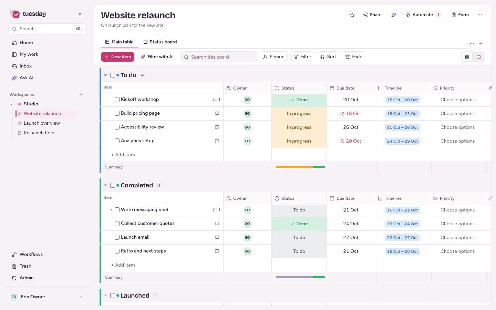
  <p><em>Board table with groups, typed columns and saved views.</em></p>
</div>

- Boards have groups, typed columns, subitems, table, kanban, calendar and timeline views, filters, saved views, bulk edit, undo, import/export and templates.
- Home is a ranked focus queue. My work, Inbox, updates with @mentions, files, dependencies, time tracking and keyboard navigation cover the daily work.
- Automations include 16 recipes, board-specific LLM templates, a sentence builder for chained subitem actions, run history, pause/duplicate and signed outbound webhooks.
- Workflows are org-level and cross-board. A trigger on one board can create an item on another, copy values, assign the source person, post a tagged note and notify. Each run is logged.
- AI includes the assistant with board context, board generation, AI columns, summaries, writing help, meeting notes, budgets, routing and optional organisation memory.
- Docs are versioned markdown. Dashboards have number, chart, list, risk and AI widgets.
- Admin includes a live setup guide, roles, private boards, guests, OIDC SSO, SMTP, audit log, sessions, API tokens, local and off-site backups, health, metrics and a go-live checklist.
- The PWA installs, queues work offline, sends push notifications, accepts Android shares and has mobile navigation.

---

<a name="screenshots"></a>
<details id="screenshots">
<summary><strong>More screenshots: kanban, automations, docs and mobile</strong></summary>

### Boards: kanban

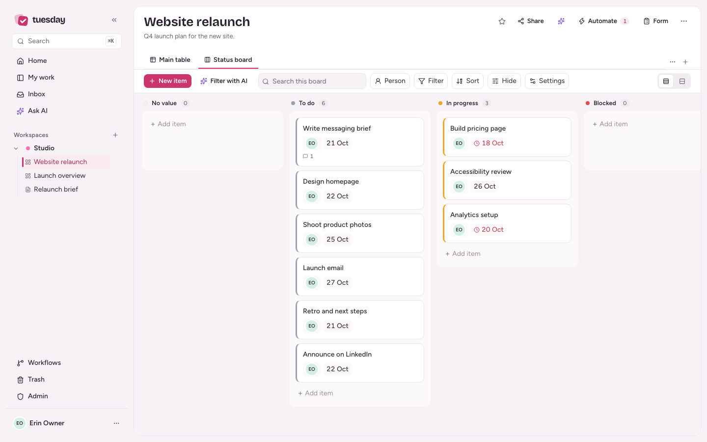

### Automations: recipes and board-specific templates

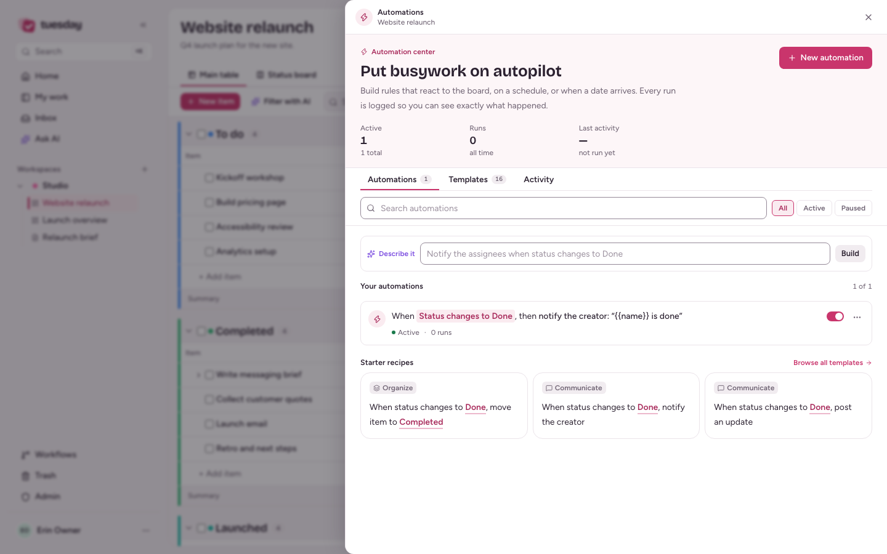

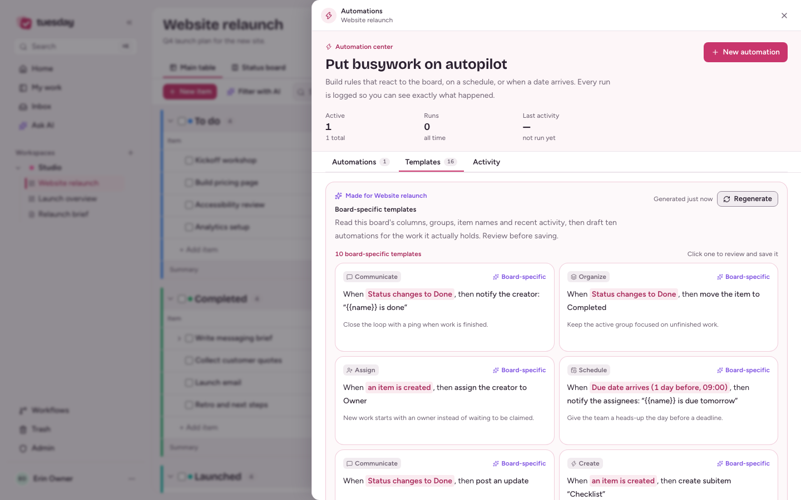

### Workflows: cross-board handoffs

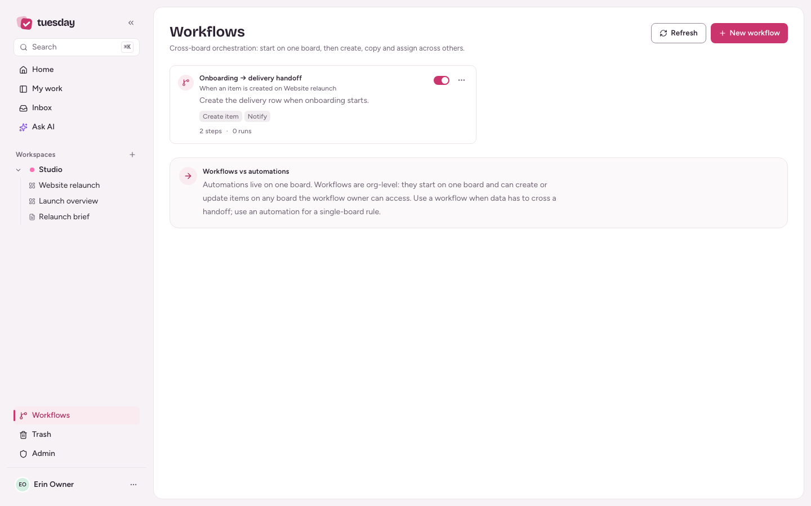

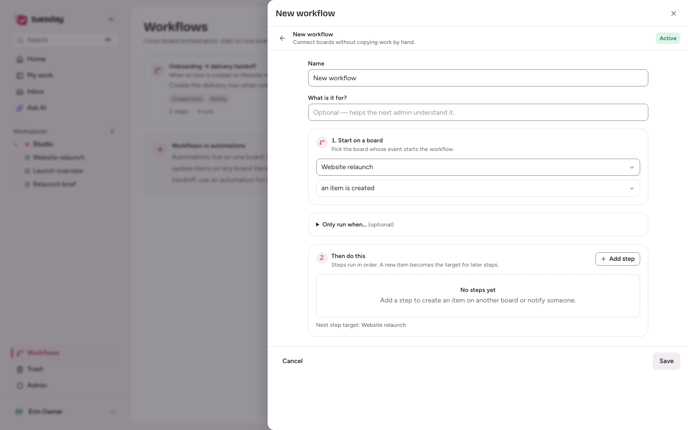

### Item panel, dashboard and docs

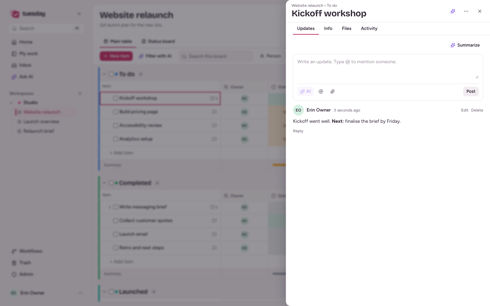

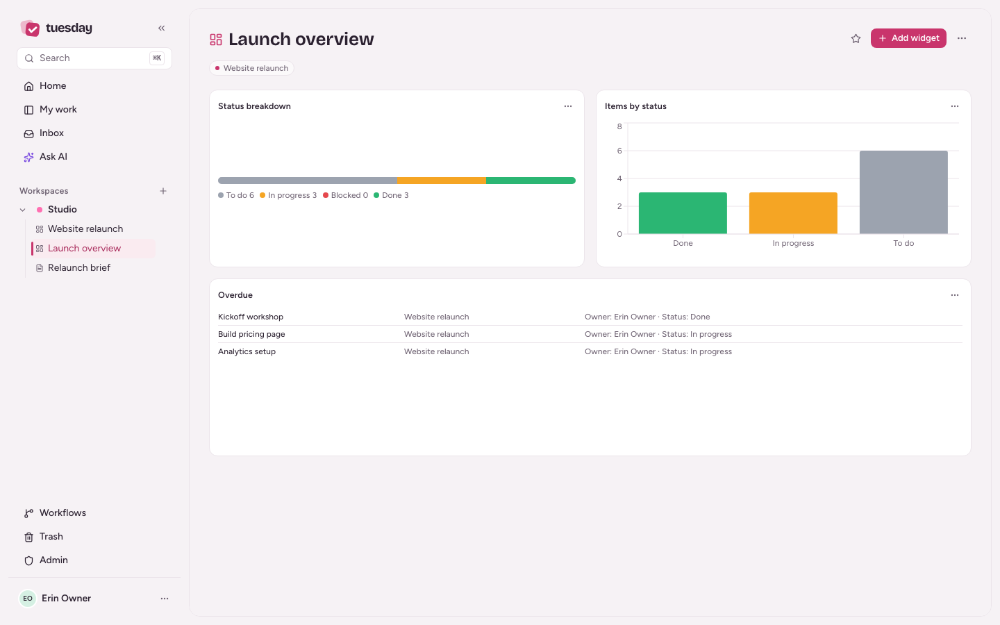

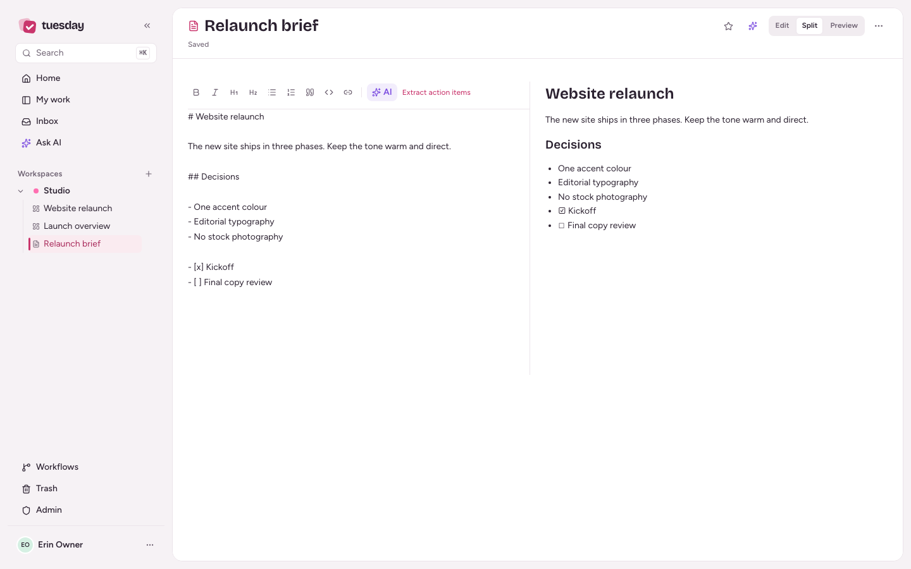

### My work, mobile and dark mode

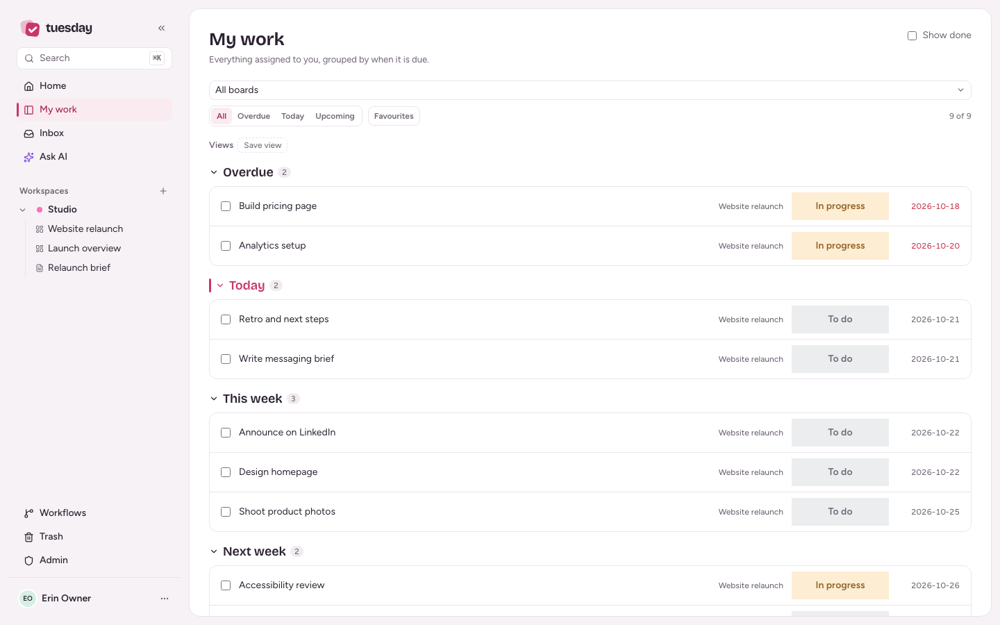

<div align="center">
  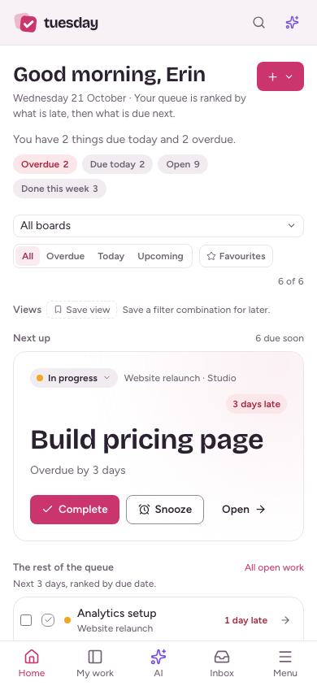
</div>

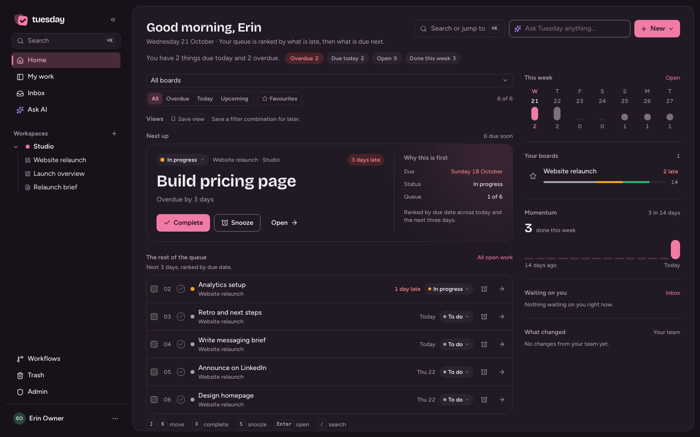

</details>

---

<a name="quick-start"></a>

## Quick start

Requires Docker Engine 24+ with Compose, 2 GB RAM and a persistent volume. Node.js 24+ is only needed for local development.

```bash
git clone https://github.com/itchyparrot53/tuesday..git
cd tuesday
cp .env.example .env
# Set APP_URL. OPENROUTER_API_KEY is optional.
docker compose up -d --build
```

> [!TIP]
> Open http://localhost:3000 and complete the first-run setup. There is no default account. The first visitor creates the owner.

```bash
docker compose logs -f tuesday
curl http://localhost:3000/api/health
docker compose down   # keeps the tuesday-data volume
```

For production, set `APP_URL` to the public HTTPS origin, `COOKIE_SECURE=true` and `TRUST_PROXY=true`, then put a reverse proxy in front. See [operations](docs/OPERATIONS.md).

To use the published image instead of building from source:

```bash
cp .env.example .env
TUESDAY_VERSION=v0.1.0 docker compose -f docker-compose.release.yml up -d
```

Tagged releases publish a multi-arch image to GHCR. Pull a pinned version when you upgrade.

---

<a name="configuration"></a>
<details id="configuration">
<summary><strong>Configuration</strong></summary>

Start from `.env.example`. The essentials:

| Variable                                                | Default                 | Why it matters                                                                         |
| ------------------------------------------------------- | ----------------------- | -------------------------------------------------------------------------------------- |
| `APP_URL`                                               | `http://localhost:3000` | Public origin for invite links, email, webhooks and the AI referer. No trailing slash. |
| `COOKIE_SECURE`                                         | `false`                 | Set `true` when served over HTTPS.                                                     |
| `TRUST_PROXY`                                           | `false`                 | Set `true` behind a reverse proxy that sets `X-Forwarded-For`.                         |
| `OPENROUTER_API_KEY`                                    | empty                   | Enables AI. Leave empty for a no-AI install.                                           |
| `SMTP_HOST` / `SMTP_USER` / `SMTP_PASS` / `MAIL_FROM`   | empty                   | Invites, password resets, mentions and digests.                                        |
| `OIDC_ISSUER` / `OIDC_CLIENT_ID` / `OIDC_CLIENT_SECRET` | empty                   | SSO. Redirect URI: `{APP_URL}/api/auth/oidc/callback`.                                 |
| `BACKUP_S3_*`                                           | empty                   | Encrypted off-site backups to any S3-compatible bucket.                                |
| `VAPID_SUBJECT`                                         | empty                   | Contact for web push. Keys are generated on first use.                                 |
| `AI_FAKE` / `MAIL_FAKE` / `PUSH_FAKE`                   | `false`                 | Development only. Never enable in production.                                          |

The full variable reference, secret rotation and troubleshooting are in [docs/OPERATIONS.md](docs/OPERATIONS.md). API tokens are in [docs/API.md](docs/API.md).

</details>

<a name="architecture"></a>
<details id="architecture">
<summary><strong>Architecture</strong></summary>

```text
Browser
  React 19 · Vite · TanStack Query · Tailwind 4 · PWA
        │  HTTPS + SSE
        ▼
Fastify 5 API
  TypeScript · SQLite (WAL) · migrations · in-process job queue
        │
        ├── /data/tuesday.db       source of truth
        ├── /data/uploads          item files
        ├── /data/backups          local archives
        └── optional adapters      OpenRouter · SMTP · OIDC · S3 · Web Push
```

| Path       | What lives there                                               |
| ---------- | -------------------------------------------------------------- |
| `server/`  | Fastify routes, services, auth, AI, jobs and SQLite migrations |
| `shared/`  | Types and Zod schemas shared by server and web                 |
| `web/src/` | React app, board views, design system and PWA code             |
| `e2e/`     | Playwright specs, isolated test server and design gallery      |
| `tests/`   | Vitest server and unit tests                                   |
| `deploy/`  | Caddy, Cloudflare Tunnel and production Compose examples       |
| `docs/`    | Operations, API, privacy, release and the public release plan  |

SQLite runs in WAL mode with numbered migrations and a database-backed job queue for email, webhooks, AI and backups. SSE keeps board updates live, and one `/data` volume holds everything stateful.

Security is enforced on the server for boards, items, docs, dashboards, AI tools, SSE and notifications. Sessions use HttpOnly cookies with CSRF protection, and webhooks are HMAC-signed.

</details>

<details id="development">
<summary><strong>Development and testing</strong></summary>

```bash
git clone https://github.com/itchyparrot53/tuesday..git
cd tuesday
npm install
npm run dev
```

Open http://localhost:5173. Vite proxies `/api` to Fastify on port 3000. The default database is `./data/tuesday.db`; set `TUESDAY_NO_DOTENV=1` to ignore `.env`.

| Command                | What it does                                     |
| ---------------------- | ------------------------------------------------ |
| `npm run dev`          | Fastify with `tsx watch` + Vite together         |
| `npm run build`        | Build the web app and server bundle              |
| `npm start`            | Run the production build                         |
| `npm run typecheck`    | Type-check web and server                        |
| `npm test`             | Run the Vitest suite                             |
| `npm run e2e`          | Build and run the Playwright suite on port 3200  |
| `npm run check:design` | Design lint (must be `0 design finding(s)`)      |
| `npm run check:colors` | Reject hard-coded colours outside token files    |
| `npm run smoke`        | Docker build, restart and deep-health smoke test |

E2E uses an isolated SQLite database with fake AI, email, push and S3 adapters. It never touches your data. The design gallery covers every screen at 1440/375 in light and dark, and the suite runs axe on every captured screen.

</details>

<a name="self-hosting"></a>
<details id="self-hosting">
<summary><strong>Self-hosting and upgrades</strong></summary>

- Install, upgrade, every environment variable, backups, restore, health, metrics and email, SSO and push troubleshooting are in the [operations runbook](docs/OPERATIONS.md).
- The [Caddy example](deploy/Caddyfile.example), [Cloudflare Tunnel example](deploy/cloudflared.example.yml) and [production Compose example](deploy/docker-compose.prod.example.yml) cover HTTPS.
- Bearer tokens, CSV and file calls, webhooks and errors are in the [API reference](docs/API.md).
- HTTPS, email DNS, backups, go-live and rollback are in the [release checklist](docs/RELEASE.md).
- Backups are local archives plus optional encrypted S3-compatible copies. Test a restore with `scripts/restore-drill.sh` before trusting it.

### Prebuilt image

Only version tags publish a multi-arch image for linux/amd64 and linux/arm64 to `ghcr.io/itchyparrot53/tuesday`.

```bash
cp .env.example .env
TUESDAY_VERSION=v0.1.0 docker compose -f docker-compose.release.yml up -d
```

`latest` follows the newest stable tag. Pin a version in production.

### Upgrades

From source:

```bash
git fetch --tags
git checkout v0.1.0
docker compose up -d --build
# Check /api/health and the Admin go-live checklist.
```

From the published image:

```bash
TUESDAY_VERSION=v0.2.0 docker compose -f docker-compose.release.yml pull
TUESDAY_VERSION=v0.2.0 docker compose -f docker-compose.release.yml up -d
# Check /api/health and the Admin go-live checklist.
```

</details>

---

## Documentation

- [Operations](docs/OPERATIONS.md)
- [API](docs/API.md)
- [Release](docs/RELEASE.md)
- [Privacy](docs/PRIVACY.md)
- [Public release plan](docs/PUBLIC-RELEASE-PLAN.md)
- [Contributing](CONTRIBUTING.md)
- [Security](SECURITY.md)
- [Changelog](CHANGELOG.md)

---

<a name="support"></a>

## Support

Questions and setup help go to [GitHub Discussions](https://github.com/itchyparrot53/tuesday./discussions). Bugs and feature requests go to [GitHub Issues](https://github.com/itchyparrot53/tuesday./issues). Vulnerabilities go through the private advisory in [SECURITY.md](SECURITY.md).

Tuesday is maintained on a best-effort basis. There is no SLA, hosted support or guaranteed response time for the public beta.

## Contributing

Read [CONTRIBUTING.md](CONTRIBUTING.md) before opening a pull request, and follow the [Code of Conduct](CODE_OF_CONDUCT.md).

## Licence

MIT. See [LICENSE](LICENSE).

Tuesday is not affiliated with, endorsed by or connected to monday.com.

---

## Star history

<a href="https://star-history.com/#itchyparrot53/tuesday.&Date">
  <picture>
    <source media="(prefers-color-scheme: dark)" srcset="https://api.star-history.com/svg?repos=itchyparrot53/tuesday.&type=Date&theme=dark" />
    <source media="(prefers-color-scheme: light)" srcset="https://api.star-history.com/svg?repos=itchyparrot53/tuesday.&type=Date" />
    
  </picture>
</a>
