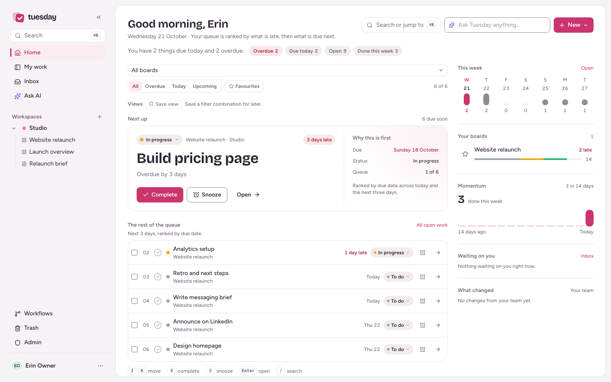

<div align="center">


<h1>Tuesday</h1>

<p><strong>Work management that runs on your server.</strong></p>

<p>Boards, docs, dashboards, automations and optional AI — in one container, on one SQLite volume, with no SaaS in the middle.</p>


[Quick start](#-quick-start) · [Screenshots](#screenshots) · [Docs](docs/OPERATIONS.md) · [Self-hosting](#self-hosting) · [Contributing](CONTRIBUTING.md)

</div>

---

## 🗓️ What is Tuesday?

Tuesday is a self-hosted work OS for teams that want the clarity of a modern work-management tool without handing their data to one. It combines monday-style boards with docs, dashboards, automations, a focus queue and an optional AI layer.

It is deliberately small to operate: **one Docker container, one SQLite database, one `/data` volume**. There is no Redis, no Postgres and no required cloud service. AI, email, SSO, off-site backups and push notifications are optional.

> **v0.1.0 — public beta.** The core is built and tested; APIs may change before 1.0. Back up your data and pin a release tag for production.

> Not affiliated with, endorsed by, or connected to monday.com.

## ✨ Why Tuesday?

- **Self-hosted by default.** Your database, files and backups stay on your hardware. The only outbound calls are the ones you configure.
- **Real work, not just cards.** Typed columns, subitems, dependencies, files, time tracking, docs, dashboards and an inbox share one permission model.
- **Automations and workflows.** Board-scoped recipes for the small loops; org-level workflows that carry data across boards and handoffs.
- **AI is optional and budgeted.** Use your own OpenRouter key, or run everything without AI. Every call goes through budgets, routing and usage reporting. [What leaves the server](docs/PRIVACY.md).
- **Seven day-named palettes.** Monday is the default; each day chooses a sensible light/dark default when selected, then you can override it.
- **Small operational surface.** One process, one SQLite file, a database-backed job queue, a health endpoint and a documented restore drill.

<div align="center">
  
  <p><em>Home turns everything assigned to you into a ranked focus queue.</em></p>
</div>

## 🚀 Quick start

Requires Docker Engine 24+ with Compose, 2 GB RAM and a persistent volume. Node.js 24+ is only needed for local development.

```bash
git clone https://github.com/itchyparrot53/tuesday..git
cd tuesday
cp .env.example .env
# Set APP_URL. OPENROUTER_API_KEY is optional.
docker compose up -d --build
```

Open **http://localhost:3000** and complete the first-run setup. There is no default account — the first visitor creates the owner.

```bash
docker compose logs -f tuesday
curl http://localhost:3000/api/health
docker compose down   # keeps the tuesday-data volume
```

For production, set `APP_URL` to the public HTTPS origin, `COOKIE_SECURE=true` and `TRUST_PROXY=true`, then put a reverse proxy in front. See [operations](docs/OPERATIONS.md). A prebuilt `ghcr.io` image is planned for the first tagged release.

## 🧭 What's inside

- **Boards:** groups, typed columns, subitems, table/kanban/calendar/timeline views, filters, saved views, bulk edit, undo, import/export and templates.
- **Work:** Home focus queue, My work, Inbox, updates with @mentions, files, dependencies, time tracking and keyboard navigation.
- **Automations:** 16 recipes, board-specific LLM templates, a sentence builder for chained subitem actions, run history, pause/duplicate and signed outbound webhooks.
- **Workflows:** org-level, cross-board handoffs — trigger on one board, create an item on another, copy values, assign the source person, post a tagged note and notify. Each run is logged.
- **AI:** assistant with board context, board generation, AI columns, summaries, writing help, meeting notes, budgets, routing and optional organisation memory.
- **Docs and dashboards:** versioned markdown docs and number/chart/list/risk/AI widgets.
- **Admin and operations:** a live admin setup guide, roles, private boards, guests, OIDC SSO, SMTP, audit log, sessions, API tokens, local/off-site backups, health, metrics and a go-live checklist.
- **PWA:** installable, offline outbox, push notifications, Android share target and mobile navigation.

<details id="screenshots">
<summary><strong>📸 Screenshots</strong> — boards, automations, docs and mobile</summary>

### Boards — table and kanban


### Automations — recipes and board-specific templates


### Workflows — cross-board handoffs


### Item panel, dashboard and docs


### My work, mobile and dark mode


<div align="center">
  
</div>


</details>

<details>
<summary><strong>⚙️ Configuration</strong></summary>

Start from `.env.example`. The essentials:

| Variable                                                | Default                 | Why it matters                                                                         |
| ------------------------------------------------------- | ----------------------- | -------------------------------------------------------------------------------------- |
| `APP_URL`                                               | `http://localhost:3000` | Public origin for invite links, email, webhooks and the AI referer. No trailing slash. |
| `COOKIE_SECURE`                                         | `false`                 | Set `true` when served over HTTPS.                                                     |
| `TRUST_PROXY`                                           | `false`                 | Set `true` behind a reverse proxy that sets `X-Forwarded-For`.                         |
| `OPENROUTER_API_KEY`                                    | empty                   | Enables AI. Leave empty for a no-AI install.                                           |
| `SMTP_HOST` / `SMTP_USER` / `SMTP_PASS` / `MAIL_FROM`   | empty                   | Invites, password resets, mentions and digests.                                        |
| `OIDC_ISSUER` / `OIDC_CLIENT_ID` / `OIDC_CLIENT_SECRET` | empty                   | SSO. Redirect URI: `{APP_URL}/api/auth/oidc/callback`.                                 |
| `BACKUP_S3_*`                                           | empty                   | Encrypted off-site backups to any S3-compatible bucket.                                |
| `VAPID_SUBJECT`                                         | empty                   | Contact for web push; keys are generated on first use.                                 |
| `AI_FAKE` / `MAIL_FAKE` / `PUSH_FAKE`                   | `false`                 | Development only. Never enable in production.                                          |

The full variable reference, secret rotation and troubleshooting are in [docs/OPERATIONS.md](docs/OPERATIONS.md). API tokens are in [docs/API.md](docs/API.md).

</details>

<details>
<summary><strong>🏗️ Architecture</strong></summary>

```text
Browser
  React 19 · Vite · TanStack Query · Tailwind 4 · PWA
        │  HTTPS + SSE
        ▼
Fastify 5 API
  TypeScript · SQLite (WAL) · migrations · in-process job queue
        │
        ├── /data/tuesday.db       source of truth
        ├── /data/uploads          item files
        ├── /data/backups          local archives
        └── optional adapters      OpenRouter · SMTP · OIDC · S3 · Web Push
```

| Path       | What lives there                                               |
| ---------- | -------------------------------------------------------------- |
| `server/`  | Fastify routes, services, auth, AI, jobs and SQLite migrations |
| `shared/`  | Types and Zod schemas shared by server and web                 |
| `web/src/` | React app, board views, design system and PWA code             |
| `e2e/`     | Playwright specs, isolated test server and design gallery      |
| `tests/`   | Vitest server and unit tests                                   |
| `deploy/`  | Caddy, Cloudflare Tunnel and production Compose examples       |
| `docs/`    | Operations, API, privacy, release and this plan                |

SQLite runs in WAL mode with numbered migrations, a database-backed job queue for email/webhooks/AI/backups, SSE for live board updates, and a single `/data` volume for everything stateful. Security checks are server-side across boards, items, docs, dashboards, AI tools, SSE and notifications; sessions use HttpOnly cookies with CSRF protection and webhooks are HMAC-signed.

</details>

<details>
<summary><strong>🛠️ Development and testing</strong></summary>

```bash
git clone https://github.com/itchyparrot53/tuesday..git
cd tuesday
npm install
npm run dev
```

Open **http://localhost:5173**. Vite proxies `/api` to Fastify on port 3000. The default database is `./data/tuesday.db`; set `TUESDAY_NO_DOTENV=1` to ignore `.env`.

| Command                | What it does                                     |
| ---------------------- | ------------------------------------------------ |
| `npm run dev`          | Fastify with `tsx watch` + Vite together         |
| `npm run build`        | Build the web app and server bundle              |
| `npm start`            | Run the production build                         |
| `npm run typecheck`    | Type-check web and server                        |
| `npm test`             | Run the Vitest suite                             |
| `npm run e2e`          | Build and run the Playwright suite on port 3200  |
| `npm run check:design` | Design lint (must be `0 design finding(s)`)      |
| `npm run check:colors` | Reject hard-coded colours outside token files    |
| `npm run smoke`        | Docker build, restart and deep-health smoke test |

E2E uses an isolated SQLite database with fake AI, email, push and S3 adapters. It never touches your data. The design gallery covers every screen at 1440/375 in light and dark, and the suite runs axe on every captured screen.

</details>

<details id="self-hosting">
<summary><strong>🌐 Self-hosting and upgrades</strong></summary>

- **Operations runbook:** [docs/OPERATIONS.md](docs/OPERATIONS.md) — install, upgrade, every env var, backups, restore, health, metrics, email/SSO/push troubleshooting.
- **HTTPS:** [Caddy](deploy/Caddyfile.example), [Cloudflare Tunnel](deploy/cloudflared.example.yml) and [production Compose](deploy/docker-compose.prod.example.yml).
- **API:** [docs/API.md](docs/API.md) — bearer tokens, CSV/file calls, webhooks and errors.
- **Release checklist:** [docs/RELEASE.md](docs/RELEASE.md) — HTTPS, email DNS, backups, go-live and rollback.
- **Backups:** local archives plus optional encrypted S3-compatible copies. Test a restore with `scripts/restore-drill.sh` before trusting it.

### Prebuilt image

Version tags publish a multi-arch image (linux/amd64 and linux/arm64) to `ghcr.io/itchyparrot53/tuesday`. Normal commits do not build or publish an image.

```bash
cp .env.example .env
TUESDAY_VERSION=v0.1.0 docker compose -f docker-compose.release.yml up -d
```

`latest` follows the newest stable tag; pin a version in production.

### Upgrades

From source:

```bash
git fetch --tags
git checkout v0.1.0
docker compose up -d --build
# Check /api/health and Admin → Go-live checklist.
```

From the published image:

```bash
TUESDAY_VERSION=v0.2.0 docker compose -f docker-compose.release.yml pull
TUESDAY_VERSION=v0.2.0 docker compose -f docker-compose.release.yml up -d
# Check /api/health and Admin → Go-live checklist.
```

</details>

## 📚 Documentation

[Operations](docs/OPERATIONS.md) · [API](docs/API.md) · [Release](docs/RELEASE.md) · [Privacy](docs/PRIVACY.md) · [Public release plan](docs/PUBLIC-RELEASE-PLAN.md) · [Contributing](CONTRIBUTING.md) · [Security](SECURITY.md) · [Changelog](CHANGELOG.md)

## 💬 Support and contributing

Questions and setup help go to [GitHub Discussions](https://github.com/itchyparrot53/tuesday./discussions); bugs and features go to [GitHub Issues](https://github.com/itchyparrot53/tuesday./issues); vulnerabilities go through the private advisory in [SECURITY.md](SECURITY.md). Read [CONTRIBUTING.md](CONTRIBUTING.md) before opening a PR and follow the [Code of Conduct](CODE_OF_CONDUCT.md).

Tuesday is maintained best-effort. There is no SLA, hosted support or guaranteed response time for the public beta.

## 📄 License

MIT — see [LICENSE](LICENSE). Tuesday is independent and not affiliated with monday.com.
